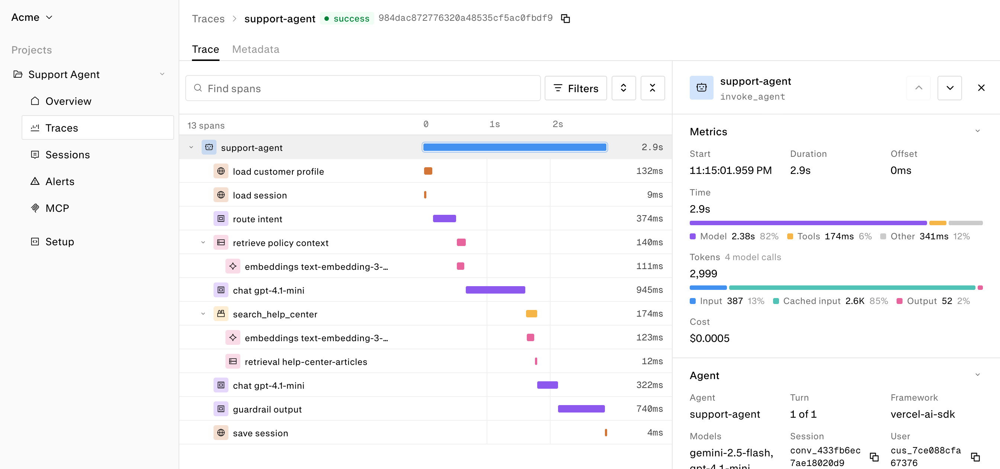

# telemetry.dev docs

This repository is the source of the [telemetry.dev documentation](https://telemetry.dev/docs). telemetry.dev records traces of AI applications and coding agents, with each model call, tool run, token count, cost, and error in one view.



The SDKs and integrations are open source in the [telemetry repository](https://github.com/telemetry-dev/telemetry). The ingest service and dashboard are hosted at [telemetry.dev](https://telemetry.dev) and their source is not public. To report a problem with a page, [open an issue](https://github.com/telemetry-dev/docs/issues) in this repository.

## Run the docs locally

You need Node.js and [pnpm](https://pnpm.io).

```sh
pnpm install
pnpm dev
```

`pnpm dev` prints the local URL. Pages are served under `/docs`.

## Check a change

```sh
pnpm test
npx blume validate
```

`pnpm test` builds the site and runs the tests in `test/`. `npx blume validate` reports broken links.

## How the repository is organized

| Path | Contents |
| --- | --- |
| `docs/` | The pages, as MDX. The path of a file is its URL under `/docs`; folders in parentheses, such as `(coding-agents)`, group pages without changing their URL. |
| `docs/**/meta.ts` | The order and titles of the pages in each sidebar section. |
| `components/figures/` | Figures drawn in HTML and CSS, so they follow the light and dark themes. `model.js` holds their data and the Markdown versions used for `.md` pages and `llms-full.txt`. |
| `public/` | Screenshots and integration marks. `public/recordings/` holds the screen recordings and their posters. [ASSET_PROVENANCE.md](ASSET_PROVENANCE.md) records where each mark came from. |
| `blume.config.ts`, `theme.css` | Site configuration and styles. The site is built with [Blume](https://www.npmjs.com/package/blume). |

## Writing guidelines

- Check each claim against the product and the released SDK versions, not against older pages. Say which SDK version a statement applies to when behavior changed between releases.
- Document what users can see and rely on: endpoints, limits, status codes, settings, and what data is sent. Leave out how the hosted service is built, such as databases, internal flags, and deployment steps.
- When a page says what is not captured or not sent, also say what still is.
- A figure or recording that shows the dashboard has to match it. When the dashboard changes, update the figure or record it again.
- Add a recording only where the page describes something that is hard to follow as text, such as a flow across several screens. Keep the text steps; the recording does not replace them.

## Deployment

Changes merged to `main` deploy to [telemetry.dev/docs](https://telemetry.dev/docs) through Cloudflare Workers Builds. Each pull request gets a preview build.
